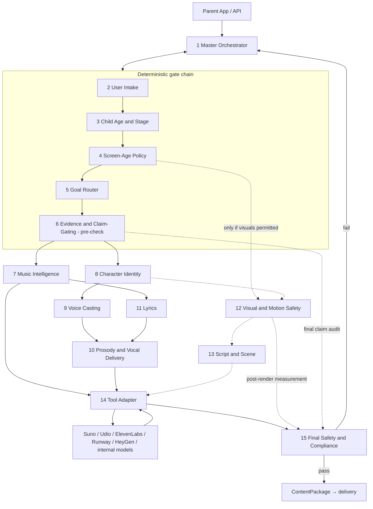

# ECMS Multi-Agent Architecture

This document specifies the full 15-agent architecture: topology, per-agent
responsibilities, inputs and outputs, and the deterministic-vs-generative split.
All object names (`ChildProfile`, `MusicSpec`, `ComplianceReport`, …) are defined
in [schemas/system.schema.json](schemas/system.schema.json). All numeric
thresholds and policy tables live in
[02-policy-matrices.md](02-policy-matrices.md) and are shipped as versioned data
files, not code — every artifact records the `policy_version` it was produced
under.

---

## 1. Design principles

1. **Generators propose, validators dispose.** Creative models never make
   safety, age, or claim decisions. Deterministic validators gate every
   generative output; the Final Safety & Compliance Agent holds an absolute,
   fail-closed veto.
2. **Audio is the product; video is an earned, gated add-on.** The pipeline is
   shaped so that the audio path is always complete on its own. The visual
   branch only exists when the Screen-Age Policy Agent unlocks it, and sleep
   content never enters the visual branch at any age.
3. **Policy as versioned data.** Age bands, modality matrices, music parameter
   envelopes, claim lists, and safety thresholds are JSON tables under
   `policies/`, semver-versioned, changed only via reviewed pull requests with
   sign-off from the child-development advisory board.
4. **Prompts are requests; measurements are guarantees.** A Runway prompt can
   ask for "slow, gentle motion" but cannot guarantee it. Every rendered asset
   is *measured* (loudness, transients, flicker, cut rate, optical flow) against
   its spec before it can ship.
5. **Humans in the loop at the right places.** New characters, new voices,
   ambiguous claims, novel content templates, and every policy change require
   human approval. Routine renders inside approved templates run autonomously.
6. **Data minimization.** The system needs a birth date (or due date) and a
   goal. It never requires the child's name, photos, or recordings; child audio
   is never captured; telemetry is opt-in and aggregate.

---

## 2. System topology

**Orchestration flow (happy path).**

1. Parent request arrives; **Master Orchestrator** opens a session, pins the
   current `policy_version`, and runs the deterministic gate chain.
2. **User Intake** structures the request; **Child Age & Stage** computes the
   age band; **Screen-Age Policy** emits the binding `ModalityPolicy`;
   **Goal Router** picks the content lane; **Evidence & Claim-Gating** pre-checks
   the intended framing (rejecting, e.g., a request themed around "make my baby
   smarter" before anything is generated).
3. The **audio spine** always runs: Music Intelligence → Character Identity →
   Voice Casting → Lyrics → Prosody.
4. The **visual branch** runs only if `ModalityPolicy` permits it *and* the lane
   is not sleep: Visual & Motion Safety → Script & Scene.
5. **Tool Adapter** compiles specs into provider jobs, executes them with seeds,
   retries, budgets, and fallbacks, and attaches provenance.
6. **Final Safety & Compliance** measures every rendered asset against its spec,
   re-runs the claim audit on all parent-facing copy, verifies required parent
   guidance, and issues a pass/fail `ComplianceReport`. Failures route back to
   the responsible agent with bounded retries (default 2), then to human review.

**Fail-closed defaults.** If any gate agent errors or times out, the
orchestrator substitutes the most restrictive policy (audio-only, no visuals,
no claims, sleep-grade stimulation caps) or halts the session. There is no code
path in which a gate failure yields a *less* restrictive outcome.

---

## 3. Agent-by-agent specification

Legend — **Type**: `DET` fully deterministic · `GEN` primarily generative ·
`HYB` generative inside deterministic constraints, deterministically validated.

### 3.1 Master Orchestrator Agent — `DET`

The conductor. A deterministic state machine (sparx `Producer` pattern): it
never generates content and never overrides a gate.

- **Responsibilities:** session lifecycle; pinning `policy_version`; invoking
  agents in dependency order; enforcing the write-whitelist (each agent may only
  write its declared output fields); retry/backoff and per-session cost budgets;
  the append-only audit log (every agent invocation, input hash, output hash,
  decision, and policy version); routing compliance failures back to the
  responsible agent; escalating to the human review queue; assembling the final
  `ContentPackage`.
- **Inputs:** `SessionRequest` (raw parent request), all agent results.
- **Outputs:** `SessionState`, `AuditLog`, `ContentPackage` (assembled, not
  authored).
- **Deterministic rules:** stage ordering; "gate agents cannot be skipped or
  reordered"; fail-closed substitution; retry limits; budget caps; no delivery
  without a passing `ComplianceReport`.
- **Generative tasks:** none.
- **Failure behavior:** halt and surface to operator; never "best effort" past a
  gate.

### 3.2 User Intake Agent — `HYB`

Turns messy parent input into a structured, consent-checked request.

- **Responsibilities:** parse free-text goals ("she fights every nap", "we're
  raising him bilingual Arabic/English"); collect structured fields (due date or
  birth date, preterm weeks if offered, languages, cultural/musical preferences,
  sensory sensitivities, household context like siblings/shift-work); verify
  account holder is an adult and consents are on file; enforce data
  minimization (child name optional and only ever used as an *optional* lyric
  token at 3y+, never required, never sent to third-party tools without explicit
  consent).
- **Inputs:** `SessionRequest` (free text + structured fields + account consent
  state).
- **Outputs:** `SessionIntent` (structured goal, context, preferences,
  sensitivities), `ConsentRecord`.
- **Deterministic rules:** required-field validation; consent gating (no
  session without guardian consent flags); PII allowlist — only whitelisted
  fields may enter the pipeline; language codes normalized to BCP-47.
- **Generative tasks:** LLM extraction of goals/context from free text; asking
  one round of clarifying questions when the goal is ambiguous.
- **Failure behavior:** if extraction confidence is low, fall back to a
  structured form; never guess a birth date.

### 3.3 Child Age & Stage Agent — `DET`

The single source of truth for "how old, developmentally, is this listener."

- **Responsibilities:** compute chronological age from birth date (or gestation
  stage from due date); apply **corrected age** for infants born preterm (until
  24 months corrected); map to one of the ten canonical age bands; attach the
  band's developmental stage descriptor (auditory maturity, attention span,
  language stage, motor stage) from the policy tables; recompute on every
  session so children migrate bands automatically.
- **Inputs:** `SessionIntent` (birth/due date, preterm weeks).
- **Outputs:** `AgeStageProfile { age_band, chronological_age_days,
  corrected_age_days?, stage_descriptors }`.
- **Age bands (enum, used everywhere):** `prenatal_t3`, `m0_3`, `m4_6`,
  `m7_11`, `m12_17`, `m18_23`, `m24_35`, `y3`, `y4`, `y5_6`.
- **Deterministic rules:** pure date arithmetic + table lookup. Band boundaries
  are never fuzzy: a child is in exactly one band.
- **Generative tasks:** none.
- **Failure behavior:** missing/invalid date → session halts at intake; no
  default age is ever assumed.

### 3.4 Screen-Age Policy Agent — `DET`

The modality gate. Converts the age band into a **binding** `ModalityPolicy`
that every downstream agent must obey.

- **Responsibilities:** look up the age band in the modality matrix
  ([02-policy-matrices.md §1](02-policy-matrices.md)); apply parent overrides
  (**parents may only restrict further, never expand** — a parent can turn video
  off for a 4-year-old but can never turn it on for a 14-month-old); apply
  lane overrides (sleep lane forces audio-only at all ages); emit session caps,
  co-viewing requirements, and parent-gate requirements.
- **Inputs:** `AgeStageProfile`, `SessionIntent` (parent restriction
  preferences), lane hint from Goal Router when re-invoked.
- **Outputs:** `ModalityPolicy { allowed_modalities[], audience_per_modality,
  co_view_required, parent_gate_required, max_session_minutes,
  max_shot_rate, autoplay: always false, policy_refs[] }`.
- **Deterministic rules:** the full age-stage matrix — prenatal/0–3m/4–6m
  audio-only (4–6m adds optional *parent-facing* static character visual);
  7–23m audio-first with no child-facing video by default (18–23m may add
  parent-controlled micro-visuals); 24–35m short co-viewed low-stimulation
  micro-video; 3y short character-led video; 4y rhythm/rhyme/routine videos;
  5–6y fuller but still low-stimulation, purposeful experiences.
- **Generative tasks:** none.
- **Failure behavior:** any lookup error → `audio` only, parent-facing only.

### 3.5 Goal Router Agent — `HYB`

Maps the parent's goal to a content lane, character archetype, and acoustic
profile family.

- **Responsibilities:** classify `SessionIntent` into one lane —
  `sleep_calm`, `play_movement`, `language_exposure`, `routine_support`,
  `bonding`, `parent_education`; select the matching character archetype
  (Sleep Guardian, Play Companion, Language Friend, Routine Buddy, Parent
  Guide); attach the lane's acoustic profile family and interaction pattern
  (e.g., call-and-response for play, echo-song for language); flag multi-goal
  requests for splitting into separate packages rather than blending
  incompatible profiles (never mix a sleep profile with a play profile in one
  track).
- **Inputs:** `SessionIntent`, `AgeStageProfile`, `ModalityPolicy`.
- **Outputs:** `GoalRoute { lane, archetype, acoustic_profile_id,
  interaction_pattern, split_recommendation? }`.
- **Deterministic rules:** lane→archetype→profile routing table; lane
  compatibility matrix (which lanes may share a session); sleep lane forces
  `ModalityPolicy` re-evaluation to audio-only.
- **Generative tasks:** LLM classification of ambiguous goals; one-line
  rationale for the audit log.
- **Failure behavior:** ambiguous below confidence threshold → default to
  `bonding` (the least claim-laden lane) and ask the parent one clarifying
  question.

### 3.6 Evidence & Claim-Gating Agent — `HYB`

The truth police. Runs **twice**: a pre-check on the requested framing, and a
final audit (inside stage 15) on every parent-facing string in the package.

- **Responsibilities:** maintain the claim registry — an **allowlist** of
  approved claim IDs with exact approved phrasings and an evidence tier
  (`established` / `emerging` / `theoretical`), and a **blocklist** of forbidden
  claims with pattern and semantic matchers; audit all copy (app text, package
  descriptions, parent guidance, lyrics when they address the parent, marketing
  strings); rewrite non-compliant copy into compliant phrasing; route
  novel/uncertain claims to the human review queue; keep the evidence registry
  linked to sources and review dates.
- **Allowed claims (only these, in approved hedged phrasings):** may support
  calming · designed for sleep-routine support · supports bonding when paired
  with caregiver interaction · uses age-aware acoustic parameters · can support
  language exposure.
- **Blocked claims (hard fail):** boosts IQ · makes babies smarter ·
  accelerates brain development · guarantees better sleep · accelerates
  bilingual fluency · replaces caregiver singing · clinically proven for all
  babies — plus their paraphrases, caught semantically, not just lexically.
- **Inputs:** pre-check: `SessionIntent` + `GoalRoute`; final: assembled
  `ContentPackage` copy.
- **Outputs:** `ClaimAudit { status: pass|rewritten|blocked|needs_review,
  claims_used[], violations[], rewrites[] }`.
- **Deterministic rules:** blocklist regex + embedding-similarity match above a
  fixed threshold = hard fail; every parent-facing benefit statement must
  carry an allowlisted claim ID; unmatched benefit statements fail; the
  allowlist can only grow via advisory-board review.
- **Generative tasks:** compliant rewriting; explanation of violations for the
  review queue.
- **Failure behavior:** fail closed — copy that cannot be confidently cleared is
  stripped to neutral descriptive text ("a slow lullaby in F major") or held.

### 3.7 Music Intelligence Agent — `HYB`

The heart of the system. Owns *musical and acoustic design as the primary
developmental mechanism* — tempo, rhythm, meter, repetition, melodic contour,
timbre, dynamics, vocal delivery constraints, phrase length, predictable
pauses, and endings. For babies, this spec — not lyrics — is the product.

- **Responsibilities:** produce a `MusicSpec` for the lane × age band within
  the hard parameter envelopes of
  [02-policy-matrices.md §2](02-policy-matrices.md); incorporate the cast
  character's music signature (keys, motifs, instrument palette) once casting
  returns; design structure (intro/sections/outro), repetition plan (for
  infants ≥ 60% repeated material, AABA or verse–refrain), phrase lengths with
  predictable pause placement, tempo automation (e.g., sleep ritardando ≤ 10%
  across the final third), dynamics targets (integrated LUFS, loudness range,
  true peak, transient ceilings), timbre palette (allowlisted instruments per
  lane/band), frequency shaping (gentle high-frequency roll-off for young
  infants, no harsh 2–5 kHz resonance), spatial rules (mono-compatible, no
  binaural motion effects for infants), and **soft endings** (sleep: ≥ 15 s fade
  resolving to the tonic; never a cold stop).
- **Inputs:** `GoalRoute`, `AgeStageProfile`, `CharacterRef.music_signature`,
  `SessionIntent.preferences` (culture, language, named favorite styles).
- **Outputs:** `MusicSpec` (see schema) + a prose *composition brief* for the
  Tool Adapter's prompt compiler.
- **Deterministic rules:** every numeric field is clamped to the lane × band
  envelope; sleep/calm must be 50–70 BPM, descending contour bias, LRA ≤ 3 LU,
  no percussive transients, no sudden transitions; play may be faster
  (band-capped), steady beat, call-and-response with response gaps sized to the
  band's response latency; a spec violating any envelope is rejected before it
  reaches generation.
- **Generative tasks:** motif and arrangement design, cultural style
  adaptation, the composition brief.
- **Failure behavior:** clamp-and-log for out-of-envelope values on first pass;
  repeated violations fail the stage.

### 3.8 Character Identity Agent — `HYB`

Registrar and casting director for the character bible.

- **Responsibilities:** maintain the character registry (each entry conforms to
  the `Character` schema: unique ID, name, role, age-band suitability,
  personality, forbidden traits, voice identity, music signature, visual
  identity, motion rules, tool-stack compatibility, safety boundaries, usage
  restrictions by age); **cast** deterministically — filter by archetype, age
  band suitability, modality, and usage restrictions, then pick by
  fit/rotation; emit the character's constraint bundle so downstream agents
  inherit its forbidden traits and motion rules; draft **new** characters
  (generative) which enter the registry only after schema validation, safety
  review, and human approval — a drafted character can never be used in the
  same session that created it.
- **Inputs:** `GoalRoute`, `AgeStageProfile`, `ModalityPolicy`, registry.
- **Outputs:** `CharacterRef` (registry entry + resolved per-band restrictions
  for this session).
- **Deterministic rules:** casting filter; archetype exclusivity (a Sleep
  Guardian never appears in `play_movement` content; Play Companion never in
  the sleep lane); cross-character rules (no Play Companion in any bedtime
  scene); registry immutability outside reviewed change control.
- **Generative tasks:** new-character drafting; per-session persona notes
  within the bible's bounds.
- **Failure behavior:** no eligible character → default archetype voice with
  no named character, flagged for catalog gap review.

### 3.9 Voice Casting Agent — `HYB`

Every character has exactly one canonical voice identity per language, with
locked provider settings.

- **Responsibilities:** resolve `CharacterRef` → `VoiceIdentity` (provider —
  ElevenLabs, Suno persona, Udio, or internal TTS; voice ID; locked
  generation settings; per-language variants; per-age *delivery variants* —
  the infant-facing variant of a voice is softer, slower, and lower-energy
  than its preschool variant); manage the fallback chain (e.g., ElevenLabs →
  internal TTS with the nearest timbre match) so a provider outage never
  changes how a character sounds beyond documented tolerance; govern voice
  creation (consented adult voice actors only, provenance recorded; **no
  cloning of real children's voices, ever**; no cloning any real person
  without written consent); run new voices through the infant-voice checklist
  (warm, soft, caregiver-like, slow, predictable, non-theatrical; never loud,
  hyperactive, sarcastic, sharp, or chaotic) with human sign-off.
- **Inputs:** `CharacterRef`, `AgeStageProfile`, `SessionIntent.languages`.
- **Outputs:** `VoiceSpec { voice_identity, provider_settings, fallback_chain,
  age_variant }`.
- **Deterministic rules:** registry lookup; variant selection by band; settings
  are locked constants per variant (e.g., ElevenLabs stability/style values are
  pinned, not improvised per request).
- **Generative tasks:** designing candidate voices for new characters
  (human-approved before registry entry).
- **Failure behavior:** provider down → fallback chain; no fallback → audio
  job re-planned as instrumental + hum stem from the music model.

### 3.10 Prosody & Vocal Delivery Agent — `HYB`

How the voice *moves*: the difference between a caregiver's lull and a
cartoon's shout.

- **Responsibilities:** produce a `ProsodySpec` binding delivery to the band
  and lane: speaking/singing rate (infant-facing spoken ≤ 100 wpm with
  elongated vowels; sung syllable density caps, e.g. ≤ 2 syllables/sec in
  sleep lane), pitch center and range per the voice identity
  (infant-directed style: slightly raised center, wide but *smooth* contours,
  no jagged leaps), pause map aligned to the MusicSpec's phrase gaps, breath
  sounds (natural soft breaths allowed; no gasping), emphasis rules, and the
  **canonical cue library** — fixed, exact wordings for recurring
  routine/calming cues. Calming breath cue is canonically
  **"breathe in deep, breathe out slow"**; the variant
  "breathe in slow, breathe out deep" is on the forbidden-variant list and is
  auto-corrected. Renders lyric lines + cues into delivery markup
  (SSML-like pacing/pause/pitch annotations) for the Tool Adapter.
- **Inputs:** `VoiceSpec`, `MusicSpec`, `LyricsSpec`, `GoalRoute`.
- **Outputs:** `ProsodySpec` + delivery-markup script.
- **Deterministic rules:** rate/pitch/density bounds per band × lane; cue
  library exact-match substitution; forbidden styles (shouting, sarcasm,
  whisper-ASMR extremes, vocal fry as an effect) rejected.
- **Generative tasks:** markup rendering; expressive phrasing within bounds.
- **Failure behavior:** out-of-bounds markup is clamped; cue mismatches are
  substituted with canonical text and logged.

### 3.11 Lyrics Agent — `HYB`

Words in service of the music — and for babies, deliberately secondary.

- **Responsibilities:** write lyrics per band and lane using the tiered
  lexicon: `prenatal_t3`–`m7_11` — vowel-forward hums and syllables
  ("loo", "mmm", "ahh") with at most a few concrete comfort words; `m12_17`–
  `m18_23` — one- and two-word repetitions of routine and body words; `m24_35`
  — short repeated lines naming actions; `y3`+ — simple narrative rhyme with
  refrains; respect repetition ratios, rhyme scheme constraints, and syllable
  density caps from the MusicSpec; embed call-and-response and echo slots
  where the interaction pattern asks; content rules — no fear content, no
  scarcity/urgency, no branded or persuasive content, no food/body commands
  beyond gentle routine framing, no claims (lyrics are audited too).
- **Inputs:** `MusicSpec`, `GoalRoute`, `CharacterRef` (persona, catchphrases),
  `AgeStageProfile`, `SessionIntent.languages`.
- **Outputs:** `LyricsSpec { lines[], structure_tags, repetition_ratio,
  syllable_density, language(s), echo_slots[] }`.
- **Deterministic rules:** lexicon tier enforcement; syllable/repetition
  arithmetic checks; blocklist screen; every line mapped to a musical section.
- **Generative tasks:** the lyric writing itself, including bilingual pairing
  for language-exposure content.
- **Failure behavior:** validation failure → one regeneration with the
  violation named; second failure → fall back to hum/vowel template.

### 3.12 Visual & Motion Safety Agent — `DET` (thresholds) + measurement

Active only when `ModalityPolicy` permits visuals. Both a spec-setter and a
post-render measurement service.

- **Responsibilities:** emit the `VisualSafetySpec` for the band: palette
  (low saturation, warm, limited hues), luminance/flicker limits (**zero**
  flash sequences; no more than 3 luminance transitions per second under any
  circumstance, and general flicker energy far below photosensitivity
  thresholds; no full-screen luminance step > 10% between frames), cut rules
  (minimum shot lengths per band, cuts only on musical phrase boundaries),
  motion limits (median optical flow caps, static or slow-pan camera only, no
  zooms toward camera, no aggressive/startle character motion), scene
  simplicity (max focal elements, plain backgrounds), on-screen text rules
  (parent-facing only below y4); **measure rendered video** — flicker
  analysis, shot-boundary detection, optical-flow magnitude, saturation
  histograms — and report against spec for the compliance gate.
- **Inputs:** `ModalityPolicy`, `AgeStageProfile`, `CharacterRef`
  (visual identity + motion rules); post-render: rendered video assets.
- **Outputs:** `VisualSafetySpec`; `VisualQCReport` (post-render measurements).
- **Deterministic rules:** every threshold in
  [02-policy-matrices.md §3](02-policy-matrices.md); measurement is pure
  signal analysis.
- **Generative tasks:** none in the gate; optional style-guide prose for the
  scene writer.
- **Failure behavior:** measurement failure = asset rejected; there is no
  "close enough" for flicker or shot rate.

### 3.13 Script & Scene Agent — `HYB`

Writes the small amount of screen content the policy allows — as *routines*,
not shows.

- **Responsibilities:** produce a `ScenePlan` inside the template constraints:
  total duration ≤ `ModalityPolicy.max_session_minutes`; shot list with
  durations ≥ the band's minimum shot length; character actions that respect
  the bible's motion rules; a consistent **opening ritual** (same hello every
  time) and **closing ritual** (same goodbye, signaling the definitive end —
  the anti-autoplay ending); embedded **co-viewing prompts** addressed to the
  caregiver ("point to the box with your grown-up"); parent guidance card
  placements; per-shot visual prompts pre-constrained by `VisualSafetySpec`.
- **Inputs:** `GoalRoute`, `MusicSpec`, `LyricsSpec`, `CharacterRef`,
  `VisualSafetySpec`, `ModalityPolicy`.
- **Outputs:** `ScenePlan { shots[], rituals, coviewing_prompts[],
  guidance_card_refs[] }`.
- **Deterministic rules:** duration and shot arithmetic; ritual presence is
  mandatory; every shot must reference the safety spec; no cliffhangers, no
  "next episode" hooks, no reward loops.
- **Generative tasks:** scene writing, action choreography, prompt drafting.
- **Failure behavior:** arithmetic violations → auto-trim to template; content
  violations → regenerate once, then human review.

### 3.14 Tool Adapter Agent — `DET`

The only agent that talks to external providers. Purely mechanical: it holds
API knowledge so no other agent needs to.

- **Responsibilities:** compile specs into provider payloads —
  **Suno/Udio**: style prompt, negative/exclude styles, BPM/key/meter tags,
  structured lyrics with section tags, persona/voice references;
  **ElevenLabs**: voice ID + locked settings + delivery markup, stem-level
  synthesis for vocal layering; **Runway**: image-to-video from approved
  character stills, per-shot prompts with camera and motion constraints,
  pinned seeds and model versions; **HeyGen**: parent-facing guide videos only
  (never child-facing content); **internal models** behind the same adapter
  interface; execute with retries/backoff, per-job cost budget, provider
  fallback chains; verify deliverable integrity (duration, sample rate,
  resolution); attach provenance (model, version, seed, prompt hash, C2PA-style
  content credentials) to every asset.
- **Inputs:** `MusicSpec` + composition brief, `VoiceSpec`, `ProsodySpec`,
  `LyricsSpec`, `ScenePlan` (if any), budget envelope.
- **Outputs:** `ToolJob[]` records + rendered `Asset[]` with provenance.
- **Deterministic rules:** spec→payload mapping tables per provider; seed and
  version pinning; budget enforcement; no payload may contain fields not
  derived from an upstream spec (prompt injection out of nowhere is
  structurally impossible).
- **Generative tasks:** none — prompt *assembly* is templated, not authored.
- **Failure behavior:** retry → fallback provider → degrade (video job fails →
  package ships audio-only if the lane allows) → halt.

### 3.15 Final Safety & Compliance Agent — `DET`

The last gate. Absolute veto; fail-closed; nothing ships without its pass.

- **Responsibilities:** verify the assembled package end-to-end —
  **audio QC**: measured integrated LUFS, loudness range, true peak, transient
  scan (no spike > the lane ceiling within any 300 ms window), sudden-transition
  detection, ending-fade verification, silence-gap sanity;
  **video QC**: consume `VisualQCReport` and require every metric within spec;
  **claim audit**: re-run Evidence & Claim-Gating over every parent-facing
  string in the final package, including tool-generated text;
  **packaging rules**: age-band label present and correct; `autoplay: false`;
  no loop flags; **parent guidance present whenever any visual asset exists**
  (and for all audio: device placement — never a crib speaker, out of reach,
  ≥ 2 m from the sleep surface; volume guidance — quiet-conversation level,
  ≤ ~60 dB SPL at the child's position; overstimulation stop-cues — gaze
  aversion, arching, fussing, splayed fingers → stop and soothe; sleep content
  guidance — audio may support the routine but the caregiver, not the screen,
  settles the child); provenance completeness; policy version stamp.
- **Inputs:** assembled `ContentPackage` + all specs + QC reports.
- **Outputs:** `ComplianceReport { verdict: pass|fail, checks[],
  failures[], human_review_required }`; on pass, the sealed `ContentPackage`.
- **Deterministic rules:** every check is a measurement or exact-match test
  against the schema and policy tables; the verdict is the conjunction of all
  checks.
- **Generative tasks:** a human-readable summary for reviewers — advisory
  only, never part of the verdict.
- **Failure behavior:** fail → named failures routed back (max 2 automated
  repair cycles) → human review queue. No override path exists in software;
  overrides are human, logged, and dual-signed.

---

## 4. Deterministic vs. generative — master table

| # | Agent | Type | Deterministic core | Generative tasks |
|---|-------|------|--------------------|------------------|
| 1 | Master Orchestrator | DET | State machine, budgets, audit, fail-closed routing | — |
| 2 | User Intake | HYB | Field/consent validation, PII allowlist | Free-text goal extraction, clarifying questions |
| 3 | Child Age & Stage | DET | Date math, corrected age, band lookup | — |
| 4 | Screen-Age Policy | DET | Modality matrix, restrict-only overrides, session caps | — |
| 5 | Goal Router | HYB | Lane/archetype routing table, lane compatibility | Ambiguous-goal classification |
| 6 | Evidence & Claim-Gating | HYB | Allow/blocklists, semantic-match threshold, fail-closed strip | Compliant rewrites, reviewer explanations |
| 7 | Music Intelligence | HYB | Parameter envelopes per lane × band, clamping | Motif, arrangement, cultural adaptation, composition brief |
| 8 | Character Identity | HYB | Casting filters, archetype exclusivity, registry change control | New-character drafting (human-approved) |
| 9 | Voice Casting | HYB | Voice registry, locked settings, age variants, fallback chains | New-voice design (human-approved) |
| 10 | Prosody & Vocal Delivery | HYB | Rate/pitch/density bounds, canonical cue library | Delivery markup, expressive phrasing |
| 11 | Lyrics | HYB | Lexicon tiers, syllable/repetition math, blocklists | Lyric writing, bilingual pairing |
| 12 | Visual & Motion Safety | DET | All visual thresholds; post-render signal measurement | (optional style-guide prose) |
| 13 | Script & Scene | HYB | Duration/shot arithmetic, mandatory rituals, no hooks | Scene writing, choreography, shot prompts |
| 14 | Tool Adapter | DET | Spec→payload templates, seeds, budgets, provenance | — |
| 15 | Final Safety & Compliance | DET | All QC measurements, claim re-audit, packaging rules | (advisory reviewer summary only) |

---

## 5. Cross-cutting services

- **Policy Engine.** `policies/*.json` (age bands, modality matrix, music
  envelopes, visual thresholds, claim registry, cue library, safety rules),
  semver-versioned; loaded read-only at session start; every artifact stamped.
- **Audit trail.** Append-only log of every decision with input/output hashes;
  reconstructible end-to-end for any shipped package.
- **Human review queue.** Receives: new characters/voices, uncertain claims,
  double-failed repairs, first N renders of any new template, and all policy
  changes. Reviewers include a child-development specialist.
- **Provenance.** Every asset carries model/version/seed/prompt-hash and
  content credentials; the package manifest lists all of it.
- **Privacy.** No child audio/video capture; no behavioral-advertising
  signals; telemetry opt-in and aggregated; provider payloads carry zero PII
  beyond what consent explicitly covers (default: none).
